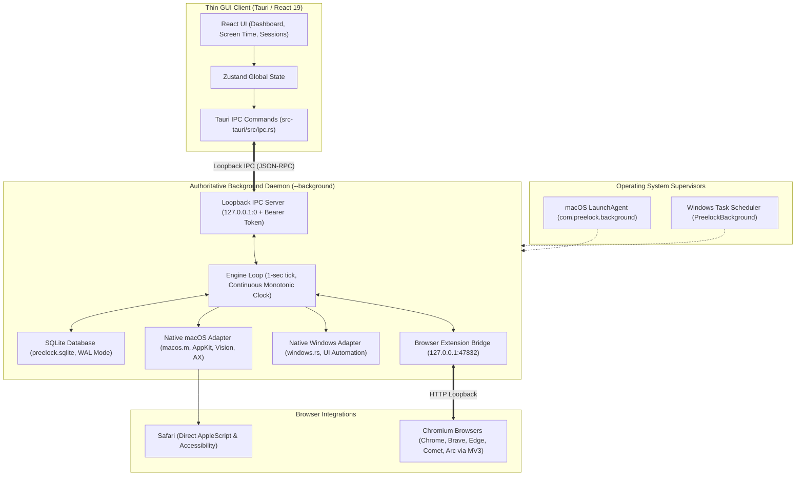

# Preelock Architecture & Component Map

This document describes the complete architecture of Preelock, its components, process supervision model, data storage, and security boundaries.

---

## 1. High-Level Architecture Overview

Preelock is structured as a local-first, dual-process desktop application built with **Tauri 2.x**, a **Rust backend**, a **React 19 / TypeScript frontend**, an **embedded SQLite database**, and an **MV3 Chromium browser extension**.

---

## 2. Process Separation & Mutex Model

### 2.1 The Two Processes

1. **Background Engine (`preelock --background`):**
   - Single authoritative owner of `Engine`, SQLite persistence, schedules, app locks, adult website blocking, and continuous timer countdowns.
   - Runs continuously in the background supervised by macOS LaunchAgent (`~/Library/LaunchAgents/com.preelock.background.plist`) or Windows Task Scheduler.
   - Protected by `engine.lock` (flock).
2. **Thin Desktop GUI (`preelock`):**
   - Renders the window, system tray menu, and modals.
   - Protected by `gui.lock` (single GUI instance, acquired before any AppKit initialization). If launched when a GUI is already running, brings the existing window to focus and exits without creating an `NSApplication`.
   - Can be closed (`Cmd+W`, `Cmd+Q`, or minimized to tray) at any time without terminating or interrupting background focus sessions or blocking enforcement.

### 2.1a macOS Application Identity (single LaunchServices entry)

LaunchServices identifies an application by bundle identifier, not by process. The GUI and the headless modes (`--background`, `--attention`, and the brief `--tray` handover) all execute `Preelock.app/Contents/MacOS/preelock`, so **only the GUI may own the notification delegate or use AppKit to locate/activate Preelock itself**. Those operations can register a second `com.preelock.desktop` identity beside the GUI; macOS may then deliver activation and notification responses to a windowless process. The background engine continues using native foreground sampling and enforcement APIs.

Rules that keep one identity:

- Headless modes never install the notification delegate or use `NSWorkspace` to locate/activate Preelock. Notifications can still be posted by the background engine; only the GUI receives click responses. Notification Center activates or cold-launches the GUI, which persists the click context for the UI to consume.
- Tray, CLI, second-instance, and supervisor launch requests use the normal LaunchServices open path (`/usr/bin/open -a`), which coalesces concurrent requests instead of racing a direct child process against a Dock or notification launch.
- The supervisor uses the exclusive `gui.lock` and GUI-written heartbeat as liveness evidence; it does not query AppKit from the headless process.
- `gui.lock` is acquired before Tauri/AppKit initialization. A losing second GUI sends an OS open request for the bundle and exits without initializing AppKit.
- Notification clicks preserve a correlation id and a non-sensitive `kind` (`reminder`, `warning`, `general`) in `notification-click.json`, consumed exactly once by the GUI. The response callback is always completed.

### 2.1b Lifecycle Diagnostics

Every process start, singleton decision, activation attempt, window presentation, notification click and shutdown writes one `key=value` line (`src/lifecycle_log.rs`) to `~/Library/Logs/Preelock/lifecycle.log` and to stderr. `bash scripts/collect-macos-diagnostics.sh` bundles those logs with the LaunchServices, process, LaunchAgent and signature state needed to diagnose activation problems. Notification text is never logged.

### 2.2 Active-Session Recovery & Re-Launch Supervisor

- During any active session, if the GUI is terminated (macOS Force Quit or Windows Task Manager), the background daemon detects GUI termination and requests GUI activation after a 500 ms confirmed-missing delay. Operating-system scheduling can add launch time.
- The supervisor treats the exclusive `gui.lock` file lock—not its persisted PID text—as proof that a GUI is alive, so a stale PID reused by another process cannot suppress recovery. A fresh GUI heartbeat is the handover fallback when the lock file is stale.
- Closing the window during an active session keeps it visible. When idle, the existing close-to-tray behavior remains; quitting the UI leaves the background engine running.

---

## 3. Communication & IPC Architecture

### 3.1 Desktop GUI to Background Engine

- **Protocol:** HTTP POST to `/rpc` on `127.0.0.1:{ephemeral_port}`.
- **Authentication:** 256-bit bearer token written to `bg-ipc.json` with `0600` permissions on startup.
- **Security:**
  - Rejects any request with an `Origin` header (prevents browser script CSRF).
  - Enforces exact `Host` matching (`127.0.0.1:{port}`) to prevent DNS rebinding.
  - Maximum payload bounded to 32 MB.

### 3.2 Browser Extension to Background Engine

- **Bridge Endpoint:** `127.0.0.1:47832` (`src-tauri/src/browser.rs`).
- **Origin Verification:** Verifies Chrome Web Store extension origin (`chrome-extension://...`).
- **Lease Model:** Blocking rules receive leases of 65 seconds refreshed on every heartbeat. If the engine stops, the extension automatically clears rules after lease expiration.

---

## 4. Website & Adult Content Blocking

### 4.1 Safari Direct Integration (macOS)

- Requires no browser extension.
- Uses native macOS Accessibility APIs (`AXUIElementCopyAttributeValue`) to read active URL and AppleScript to navigate blocked domains to `about:blank`.

### 4.2 Chromium Browsers (Chrome, Brave, Edge, Comet, Arc)

- **Primary Layer:** Declarative Net Request (DNR) session rules in MV3 extension.
- **Secondary Native Layer:** Native macOS Accessibility / Windows UI Automation monitors foreground address bars and redirects tabs directly if extension is absent or tampered with.

### 4.3 Adult Website Blocking

- Bundles an embedded list of ~50,000 adult domains compiled directly into the binary (`include_str!("../resources/adult-domains.txt")`), requiring no runtime file lookup or internet connection.
- Operates system-wide across all supported browsers.

---

## 5. Storage & Database Architecture

- **Database Engine:** Embedded SQLite with `rusqlite` bundled.
- **Path:** `com.preelock.desktop/preelock.sqlite`
- **Concurrency:** Write-Ahead Logging (`PRAGMA journal_mode=WAL;`), synchronous disk writes (`PRAGMA synchronous=FULL;`), and 5-second busy timeout.
- **Migrations:** Additive migrations `001_initial.sql` through `012_strict_blocks.sql`.
- **Reliability:** Automated pre-migration backups and `PRAGMA quick_check(1)` integrity checking on database initialization.
